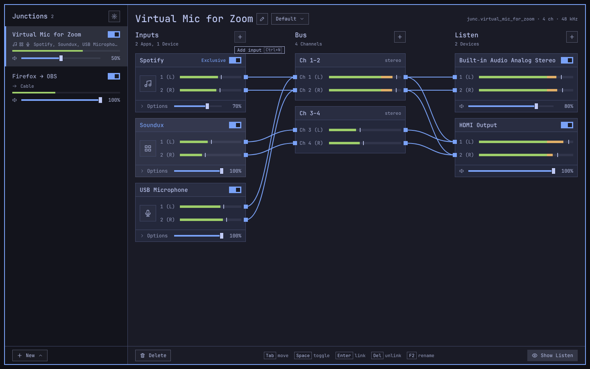

<div align="center">

# JUNC

**Declarative audio routing for PipeWire.**
Virtual microphones, app-to-app audio and multichannel mixes that survive
reboots, re-plugs and app restarts, without adding a single sample of latency.

[](https://github.com/ejsergeev/junc/actions/workflows/ci.yml)
[](https://github.com/ejsergeev/junc/tags)
[](LICENSE)


[Quick start](#quick-start) · [Concepts](#concepts) · [Configuration](#configuration) ·
[CLI](#cli) · [AI agents](#ai-agents) · [Roadmap](#status-and-roadmap) · [Contributing](#contributing)



<sub>Design of the desktop app, which is in development (beta). The daemon and CLI are available today.</sub>

</div>

---

## Why JUNC

Linux audio can already do almost anything. Keeping it that way is the hard
part. `pw-loopback` scripts, null sinks in config fragments and patchbay
links work until an app restarts, a USB interface is re-plugged or
PipeWire restarts. Then the routing is gone or wrong.

JUNC turns routing into a small **declarative config**. You say *"a mic
called Zoom Mic, made of my USB mic and Spotify at 70 %"*, and the `juncd`
daemon keeps the PipeWire graph matching that, all the time.

- **Zero added latency, bit-exact at unity.** JUNC never touches samples.
  It only creates native PipeWire nodes and links, and PipeWire's real-time
  thread does the rest. There is no extra audio thread and no extra buffering.
- **Self-healing.** Apps and devices are matched by identity (binary, node
  name, role), not by object id. When they come back, JUNC re-links them
  within milliseconds.
- **Survives restarts.** Every object JUNC owns lingers in PipeWire, so
  restarting or upgrading the daemon does not drop audio. At login, ten
  Junctions are routed in well under a second.
- **Plays well with others.** JUNC only changes objects it tagged itself.
  If you remove one of its links with another tool, JUNC reports it and does
  not fight you.
- **Every API sees it.** Junctions show up as ordinary devices to
  PulseAudio, JACK and native PipeWire apps.
- **Idle means asleep.** 0 wakeups/s when nothing changes, about 6 MB of
  memory with ten Junctions, and a 3 MB binary.
- **Built for scripts and agents.** Every command has `--json`, stable error
  codes and documented exit codes. You can validate a config and dry-run it
  before applying, and an agent skill ships in the repo.

## Concepts

```
   Inputs                     Bus                    Listen
 ┌──────────────┐        ┌──────────┐        ┌───────────────────┐
 │ USB mic      │──1,2──▶│ Ch 1–2   │──1,2──▶│ Headphones        │
 │ Spotify  70% │──1,2──▶│          │        └───────────────────┘
 │ Soundux      │──1,2──▶│ Ch 3–4   │
 └──────────────┘        └──────────┘
                    Junction "Zoom Mic"
          (apps record from it like any microphone)
```

| Term | What it is |
| --- | --- |
| **Junction** | A virtual device. Apps record from it like a microphone and can play into it like a speaker. |
| **Input** | What feeds a Junction: an app (by binary), a hardware input, what an output is playing (monitor), or another Junction. |
| **Bus** | The Junction's channels: 2 by default, up to 64. |
| **Link** | One Input channel to one Bus channel. If you set no links, JUNC uses a sensible default mapping, and a mono source feeds both sides. |
| **Listen** | An output where you hear the Junction. `default` follows the system output. |
| **Cable** | One app straight into another app, for example Spotify into OBS. |

## Quick start

> [!NOTE]
> JUNC is in **alpha** ([`v0.1.0-alpha`](https://github.com/ejsergeev/junc/releases/tag/v0.1.0-alpha)).
> The signed pacman repository and the PKGBUILD come with the beta. Until
> then, build from source.

### Requirements

- Linux with **PipeWire** and **WirePlumber** in a systemd user session.
  Tested with PipeWire 1.6 and WirePlumber 0.5 on Arch Linux and Arch Linux
  ARM (CI on every change), and on Asahi Linux on Apple Silicon.
- **Rust 1.99+**, `clang` and `pkgconf` to build.

### Build and install

```sh
# Arch Linux / Arch Linux ARM
sudo pacman -S --needed base-devel rust clang pkgconf pipewire wireplumber

git clone https://github.com/ejsergeev/junc.git
cd junc
cargo build --release --locked

sudo install -Dm755 target/release/juncd target/release/junc -t /usr/local/bin

# systemd user unit and D-Bus activation, pointed at /usr/local/bin
mkdir -p ~/.config/systemd/user ~/.local/share/dbus-1/services
sed 's|/usr/bin/|/usr/local/bin/|' packaging/systemd/juncd.service \
  > ~/.config/systemd/user/juncd.service
sed 's|/usr/bin/|/usr/local/bin/|' packaging/dbus/io.github.ejsergeev.Junc1.service \
  > ~/.local/share/dbus-1/services/io.github.ejsergeev.Junc1.service
systemctl --user daemon-reload

junc service enable   # start juncd now and at every login
junc doctor           # check PipeWire, WirePlumber, pipewire-pulse, JACK and juncd
```

### Your first virtual microphone

```sh
junc describe                                # apps and devices you can use, with exact names
junc create junction "Zoom Mic"
junc input add "Zoom Mic" --device alsa_input.usb-Blue_Yeti-00.analog-stereo
junc input add "Zoom Mic" --app spotify
junc volume "Zoom Mic" spotify 70            # Spotify a bit quieter in the mix
junc listen add "Zoom Mic" default           # optional: hear the mix yourself
junc status "Zoom Mic"
```

Now pick **Zoom Mic** as the microphone in Zoom, Discord, OBS or any other
app. To make every app use it, run `junc default "Zoom Mic" --as input`.

## Configuration

Everything lives in one TOML file, `~/.config/junc/junctions.toml`. The CLI
edits it for you and keeps your comments and ordering. You can also edit it
by hand: the daemon picks up every save, checks it, and falls back to the
last good version if it is invalid.

```toml
schema = 1

[[junction]]
id = "zoom-mic"
name = "Zoom Mic"
default = "input"                  # every app uses it as the microphone

[[junction.input]]
id = "mic"
match = { device = "alsa_input.usb-Blue_Yeti-00.analog-stereo" }
links = [[1, 1], [1, 2]]           # mono mic to both sides

[[junction.input]]
id = "spotify"
match = { binary = "spotify" }
volume = 70                        # percent, cubic like PulseAudio

[[junction.listen]]
id = "headphones"
target = "default"

[[junction]]
id = "spotify-to-obs"
name = "Spotify → OBS"
kind = "cable"
[[junction.input]]
id = "spotify"
match = { binary = "spotify" }
[junction.cable]
to = { binary = "obs" }
```

Safe workflow for larger changes:

```sh
junc config validate my.toml          # errors with file, line, column and "did you mean"
junc apply my.toml --dry-run          # what would change, in plain words
junc apply my.toml                    # do it
```

- **Full format:** [`skill/junc/junctions.md`](skill/junc/junctions.md)
- **Ready-made setups:** [`skill/junc/recipes.md`](skill/junc/recipes.md), with
  a call mic, a stream mix, app to app, separate recording tracks and nested
  Junctions
- **JSON Schema:** [`schema/junc-config-v1.json`](schema/junc-config-v1.json),
  also available from `junc schema`

## CLI

| Task | Command |
| --- | --- |
| See everything | `junc list` · `junc status [NAME]` · `junc describe` |
| Create, copy, remove | `junc create junction NAME` · `junc create cable FROM_APP TO_APP` · `junc duplicate` · `junc rename` · `junc delete NAME --yes` |
| Turn on and off | `junc enable` · `junc disable` · `junc toggle` · `junc switch NAME --as input` |
| Default device | `junc default NAME --as input\|output` · `junc default NAME --clear` |
| Inputs | `junc input add NAME --app BIN \| --device NODE \| --monitor SINK \| --junction J` · `remove` · `enable` · `disable` |
| Channels and links | `junc bus add NAME [--mono] [--count N]` · `junc link NAME mic:1 2` · `junc unlink …` |
| Hearing a mix | `junc listen add NAME default\|OUTPUT` · `junc listen remove NAME ID` |
| Volume | `junc volume NAME [INPUT \| --listen ID] PERCENT` |
| Config | `junc config path\|validate\|edit` · `junc apply FILE [--dry-run] [--expect-revision N]` · `junc schema` |
| Service and health | `junc service enable\|disable\|status` · `junc doctor` |

Junctions can be named by id or by name, in any case, and a typo gets a
"did you mean". Add `--json` to any command for one machine-readable
document:

```json
{ "junc": 1, "ok": true, "revision": 42, "data": { "…": "…" } }
```

Exit codes: `0` ok · `1` error · `2` usage · `3` invalid config ·
`4` not found · `5` conflict · `6` daemon unavailable · `7` PipeWire
unavailable · `8` needs confirmation.

The daemon also has a D-Bus API, `io.github.ejsergeev.Junc1`, documented in
[`docs/dbus.md`](docs/dbus.md).

## AI agents

JUNC ships an [agent skill](skill/junc/SKILL.md) that teaches coding agents to
set up routing from a plain request, such as *"make a mic for Zoom with my
USB mic and Spotify"*. The agent inspects the system with `junc describe`,
writes the config into a copy, validates it, shows you the dry-run plan and
applies it only after you agree.

```sh
JUNC_SKILL_DIR="$PWD/skill/junc" junc skill link   # link the skill into your agents' skills folders
junc skill status
```

## How it works

```
 junc (CLI) ─┐
 GUI, bar  ──┼── D-Bus ──▶ juncd ──▶ PipeWire graph
 agents    ──┘               ▲        (tagged, lingering nodes and links)
                             │
             ~/.config/junc/junctions.toml (desired state, inotify)
```

`juncd` is a single event-driven process. It reads the desired state, watches
the live PipeWire graph and computes a plan, using a pure, deterministic
planner that is shared with `--dry-run`. It then creates or removes only the
difference. Volumes use server-side gain nodes, and defaults go through
WirePlumber metadata. The core is platform-agnostic: PipeWire is one
implementation of a `Backend` trait.

The design is described in [`docs/architecture.md`](docs/architecture.md).

| Crate | Role |
| --- | --- |
| [`junc-core`](crates/junc-core) | Model, config, identity matcher, planner. No I/O dependencies. |
| [`junc-pw`](crates/junc-pw) | PipeWire backend |
| [`junc-ipc`](crates/junc-ipc) | D-Bus contract, shared by the daemon and its clients |
| [`juncd`](crates/juncd) | The daemon |
| [`junc-cli`](crates/junc-cli) | The `junc` command |
| [`junc-l10n`](crates/junc-l10n) | Localization |
| [`junc-gui`](crates/junc-gui) | Desktop app (Slint), in development |

## Performance

Measured for the alpha in CI on x86_64 and aarch64, and on an M1 MacBook
running Asahi Linux. The details are in [`docs/alpha-review.md`](docs/alpha-review.md).

| Metric | Target | Result |
| --- | --- | --- |
| Added latency | 0 | 0 frames, bit-exact at unity |
| Idle wakeups | 0/s | 0/s |
| Daemon memory, 10 Junctions | < 10 MB | 5.5–5.9 MB PSS |
| Restore at login, 10 Junctions | < 1 s | 114–300 ms |
| Re-link after an app or device returns | < 100 ms | p95 6–9 ms in CI, 81–101 ms on a busy desktop |
| Daemon binary | < 5 MB | 2.9–3.1 MB |

A performance gate runs on every pull request.

## Status and roadmap

| Stage | Scope | State |
| --- | --- | --- |
| **Alpha** | `juncd`, CLI, agent skill, systemd and D-Bus integration | ✅ `v0.1.0-alpha` |
| **Beta** | Volumes ✅, Exclusive ✅, Pro Audio and Bluetooth handling, import of existing setups, presets and templates, desktop app and tray, Omarchy bar plugin, signed pacman repository | 🚧 in progress |
| **v1** | Translations, 24 h soak, accessibility pass, user manual, stable channel | planned |

Known limitations right now:
- No GUI yet.
- Messages are English only.

The full plan, including known issues, is in [`docs/plan.md`](docs/plan.md).

## Troubleshooting

Start with `junc doctor`. It checks PipeWire, WirePlumber, pipewire-pulse,
JACK, the clock and `juncd`, and prints a fix for anything wrong. More help is
in [`skill/junc/troubleshooting.md`](skill/junc/troubleshooting.md). Notes on
Bluetooth and Apple Silicon are in [`skill/junc/devices.md`](skill/junc/devices.md).

When you report a bug, attach the output of `junc doctor --json`.

## Contributing

Contributions are welcome. Read [`CONTRIBUTING.md`](CONTRIBUTING.md) for the
commit and branch conventions. Contributions are accepted under the
[DCO](CONTRIBUTING.md#developer-certificate-of-origin), with no CLA.

```sh
scripts/ci/check.sh          # fmt, clippy, tests, dependency rules, cargo-deny, release build
scripts/ci/live-pipewire.sh  # integration tests against a headless PipeWire
```

## License

JUNC is free software, licensed under the
[GNU General Public License v3.0 or later](LICENSE).
